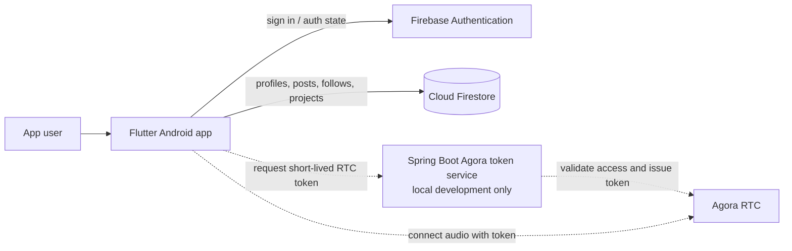
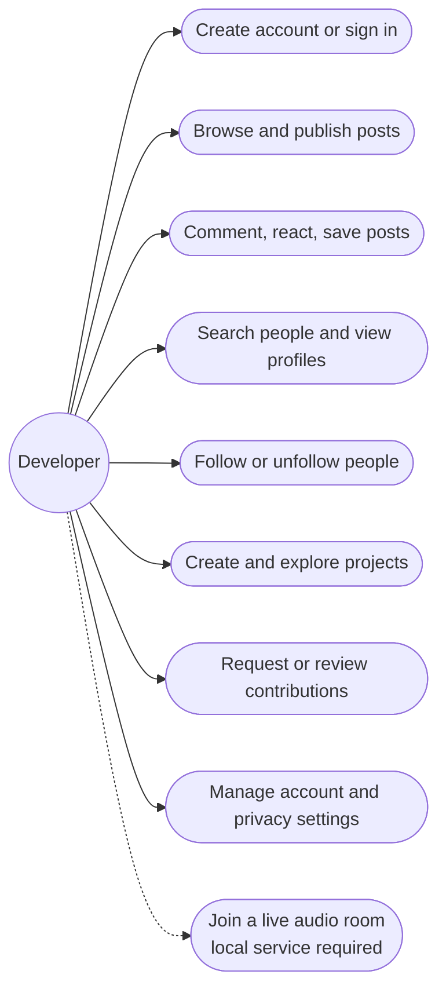
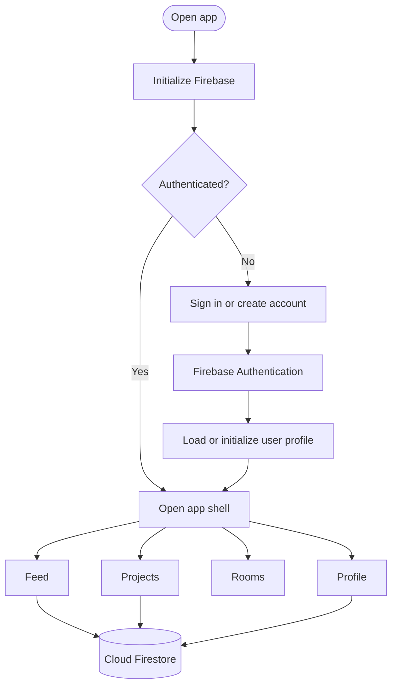

# KodeKoalesce architecture

This document describes the current project structure and its main user flows. It distinguishes Firebase-backed app features from the locally tested live-audio path.

## System design



Solid connections are the ordinary Firebase app path. Dashed connections show the live-audio path, which currently requires the developer's local token service and is not available as a public hosted feature.

## Use cases



## Sign-in and app navigation flow



## Live-room join flow

```mermaid
sequenceDiagram
    actor User
    participant App as Flutter app
    participant Firestore
    participant Token as Spring Boot token service
    participant RTC as Agora RTC

    User->>App: Start or join room
    App->>Firestore: Read room and membership data
    Firestore-->>App: Room details
    App->>Token: Request token for room and user
    Note over Token: Local development service; not publicly hosted
    Token->>Firestore: Validate Firebase identity and room access (when configured)
    Token-->>App: Short-lived Agora token
    App->>RTC: Join audio channel
    RTC-->>App: Participant and audio events
```

## Main code areas

| Path | Responsibility |
| --- | --- |
| `lib/app/` | Authentication gate, navigation shell, and app-level UI |
| `lib/core/` | Shared theme and reusable widgets |
| `lib/features/feed/` | Feed, comments, and saved posts |
| `lib/features/profile/` | Profiles, discovery, follows, and external links |
| `lib/features/projects/` | Project pages, contribution requests, and notifications |
| `lib/features/rooms/` | Room listing and Agora voice-room UI |
| `lib/screens/` | Settings and remaining screens |
| `tools/agora_token_server/` | Spring Boot service that issues Agora RTC tokens |
| `firestore.rules` | Firestore authorization rules |

## Data and security notes

- Firebase Authentication identifies the signed-in app user.
- Cloud Firestore stores app data and enforces access through `firestore.rules`.
- The Agora App Certificate is a server secret. It belongs only in a protected server environment or local ignored `.env` file; never in Flutter code or Git.
- The local token service is for development. A public audio deployment needs production authentication, room-membership checks, protected secrets, and an appropriate hosting budget.
- Use test accounts and sample content in shared demos. Firebase quotas and rules apply to every build configured for that Firebase project.
